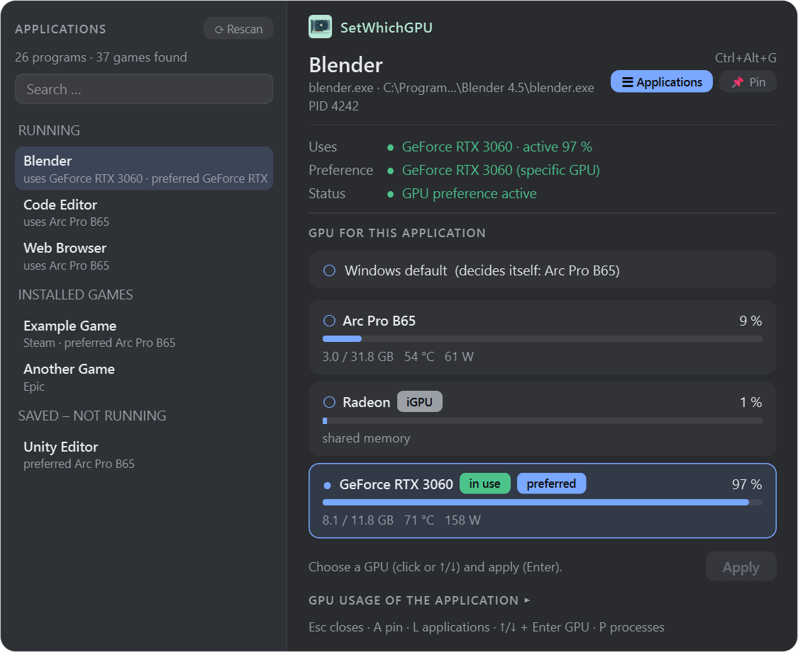
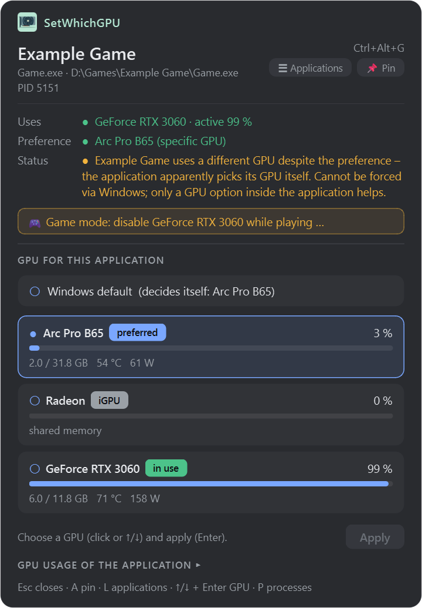

<p align="center"></p>

<h1 align="center">SetWhichGPU</h1>
<p align="center"><b>See and set which GPU every Windows app uses</b><br>Per-app GPU selection and live GPU monitoring for Windows 11 PCs with more than one graphics card</p>

<p align="center">
  <a href="https://github.com/Mastertoken/SetWhichGPU/actions/workflows/ci.yml"></a>
  <a href="LICENSE"></a>
  
  
</p>

<p align="center"><a href="https://github.com/Mastertoken/SetWhichGPU/releases/latest/download/SetWhichGPU-setup.exe"><b>Download</b></a> · <a href="https://mastertoken.github.io/SetWhichGPU/"><b>Website</b></a> · <a href="#install">Install</a> · <a href="#faq">FAQ</a></p>

SetWhichGPU is a free, open-source tray app for Windows 11. Press **`Ctrl+Alt+G`** over any application to see **which GPU it really runs on**, next to **the GPU Windows is told to use** – and change it in two clicks. Made for laptops with integrated + dedicated graphics and desktops with several GPUs (NVIDIA, AMD, Intel Arc).

<p align="center"></p>

> **Status: early development (pre-release).** Expect rough edges. Developed and tested on a Windows 11 PC with an NVIDIA GeForce RTX 3060, an Intel Arc Pro B65 and an AMD Radeon iGPU – reports from other setups are very welcome.

## Features

- **Hotkey overlay** (`Ctrl+Alt+G`) above the active application – works over borderless fullscreen, on several monitors and with mixed DPI
- **Measured vs. preferred GPU** side by side – never mixed up
- **Per-app GPU selection** via the Windows graphics preference: default, power saving, high performance or one **specific GPU** (essential with three or more GPUs)
- **Honest status**: "active", "restart required" (only if the app was started *before* the change) or "the app picks its GPU itself"
- **Live GPU monitoring** per GPU (load, VRAM, temperature, power) and per application, including CUDA compute
- **Application list**: running apps, background GPU processes, saved preferences, installed programs and Steam, Epic and GOG games – set the GPU *before* starting an app
- **Pin mode**: the overlay stays visible and follows the active application
- **Optional game mode** for games that ignore the Windows preference (see below)
- **Journaled and reversible**: every registry change is logged first and can be undone from the tray menu
- **English, German, Spanish and French** UI (follows Windows, switchable in the tray menu)

## Why not just Windows Settings?

Windows (*Settings → System → Display → Graphics*) can tell an app to use a specific GPU, but it never shows **which GPU the app actually ended up on**, buries the setting several clicks deep, and gives no hint when an app simply ignores it. SetWhichGPU shows the measured GPU next to the stored preference, one hotkey away, for every running, installed or saved application.

## What it can and cannot do

Please read this before filing a bug – most "it doesn't work" cases are Windows limitations:

| | |
|---|---|
| ✅ | Sets the Windows per-app graphics preference (`HKCU`, no admin rights) |
| ⏳ | Changes take effect **the next time the app starts** – Windows cannot move a running process to another GPU |
| ❌ | Apps that **choose their GPU themselves** ignore the Windows preference (many games, Blender Cycles' render device, CUDA/AI tools). SetWhichGPU detects and reports this |
| ❌ | No overlay in **exclusive fullscreen** (a tray notification is shown instead) |
| ⚠️ | The "specific GPU" option uses the same – undocumented – registry format the Windows Settings app writes. A future Windows update could change it |
| ⚠️ | Two **identical** GPUs (same model and board vendor) cannot be told apart by Windows; selection is disabled in that case |
| ℹ️ | Temperature/power: NVIDIA (NVML) and Intel Arc (IGCL). AMD telemetry is not implemented yet |

SetWhichGPU never modifies drivers, never injects into other processes and sends no telemetry.

### Game mode (optional)



Some games enumerate all GPUs and pick one themselves. When SetWhichGPU proves that (the game was started *after* the preference was set and still runs elsewhere), it offers **game mode**: the unwanted GPU is **temporarily disabled** after you close the game, you start the game again, and the GPU is **enabled again automatically** when the game exits.

Safety rules ([ADR-0002](docs/adr/0002-spielmodus-gpu-voruebergehend-deaktivieren.md), German): a GPU with a monitor attached and the only GPU are never disabled; GPUs another process is computing on are refused; the GPU is re-enabled on game exit, timeout, from the tray, when quitting and on the next start after a crash. Game mode is the only feature that asks for administrator rights (one UAC prompt per session, `pnputil /disable-device` / `/enable-device`, never `/force`).

<br clear="right">

## Install

**[⬇ Download SetWhichGPU-setup.exe](https://github.com/Mastertoken/SetWhichGPU/releases/latest/download/SetWhichGPU-setup.exe)** (Windows 11, 64-bit, ~19 MB) and run it. Release notes and SHA-256 checksum: [latest release](https://github.com/Mastertoken/SetWhichGPU/releases/latest).

- Installs **for your user only – no administrator rights** (optionally for all users)
- Options: start with Windows, desktop shortcut
- Uninstall via *Settings → Apps*: closes SetWhichGPU, removes autostart and asks whether to **restore the GPU preferences** it changed and whether to delete its settings and logs
- The installer is not code-signed yet, so Windows SmartScreen may warn ("Windows protected your PC" → *More info* → *Run anyway*). Each release lists the SHA-256 checksum of the installer

SetWhichGPU then lives in the system tray. Language: tray menu → *Language*. Hotkey: `Ctrl+Alt+G` (another one via the environment variable `GPUCC_HOTKEY`, e.g. `Ctrl+Shift+F9`; a settings dialog is planned).

### Run from source

Requirements: **Windows 11**, **Python 3.13** and **[uv](https://docs.astral.sh/uv/)**.

```powershell
git clone https://github.com/Mastertoken/SetWhichGPU.git
cd SetWhichGPU
uv sync
uv run python -m gpucc
```

Build the installer yourself: `.\tools\release\build_installer.ps1` (needs [Inno Setup 6](https://jrsoftware.org/isinfo.php): `winget install JRSoftware.InnoSetup`). Official installers are built by GitHub Actions ([release workflow](.github/workflows/release.yml)); each release links the run that built it.

**Code signing policy:** free code signing provided by [SignPath.io](https://about.signpath.io/), certificate by [SignPath Foundation](https://signpath.org/) (application pending – releases are unsigned until then). Committers, reviewers and approvers: [Mastertoken](https://github.com/Mastertoken). **Privacy:** this program will not transfer any information to other networked systems unless specifically requested by the user or the person installing or operating it.

## FAQ

**How do I make an app use a specific GPU on Windows 11?**
Press `Ctrl+Alt+G` over the app (or pick it from the application list), click the GPU and *Apply*. It takes effect the next time the app starts.

**How can I see which GPU a program is actually using?**
The overlay measures GPU engine activity and video memory per process (Windows performance counters, plus NVML for NVIDIA and IGCL for Intel Arc) and shows the measured GPU next to the preference.

**Why does my game or Blender ignore the GPU preference?**
It chooses its GPU itself; Windows cannot override that. SetWhichGPU says so instead of pretending. For Blender Cycles/CUDA tools, pick the device inside the app; for games, game mode can help.

**Does it work on laptops (iGPU + dGPU) and with AMD?**
Yes – with any GPUs Windows exposes as separate adapters. AMD telemetry (temperature/power) is not implemented yet; load and VRAM work.

## Development

```powershell
uv run pytest                                        # unit tests (no GPU needed)
uv run pytest -m windows                             # read-only tests against real Windows APIs
$env:GPUCC_HW_TESTS='1'; uv run pytest -m hardware   # tests against real GPUs
uv run ruff check . ; uv run ruff format --check . ; uv run mypy src
uv run python tools/assets/make_screenshots.py       # regenerate README/website screenshots
```

Architecture: [docs/architecture/PHASE1_ARCHITEKTUR.md](docs/architecture/PHASE1_ARCHITEKTUR.md) (German), decisions in [docs/adr/](docs/adr/), feasibility spikes in [docs/spikes/](docs/spikes/). Rules for contributors and AI coding agents: [AGENTS.md](AGENTS.md). Translations live in [src/gpucc/i18n/](src/gpucc/i18n/) – new languages are welcome; a test checks that every string is translated.

This project is developed with the help of AI coding agents (Claude Code, Codex CLI) under human review; see [AGENTS.md](AGENTS.md) for the rules they follow.

## Contributing, security, license

- [CONTRIBUTING.md](CONTRIBUTING.md) – how to report bugs (please include your GPU setup and Windows build) and send changes
- [SECURITY.md](SECURITY.md) – how to report vulnerabilities privately
- [THIRD_PARTY_NOTICES.md](THIRD_PARTY_NOTICES.md) – licenses of dependencies
- License: [MIT](LICENSE)

NVIDIA, GeForce, Intel, Arc, AMD, Radeon, Windows, Steam, Epic Games, GOG and Blender are trademarks of their respective owners. This project is not affiliated with or endorsed by any of them.
